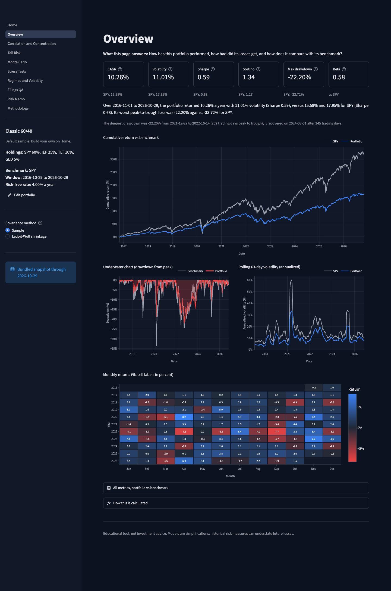
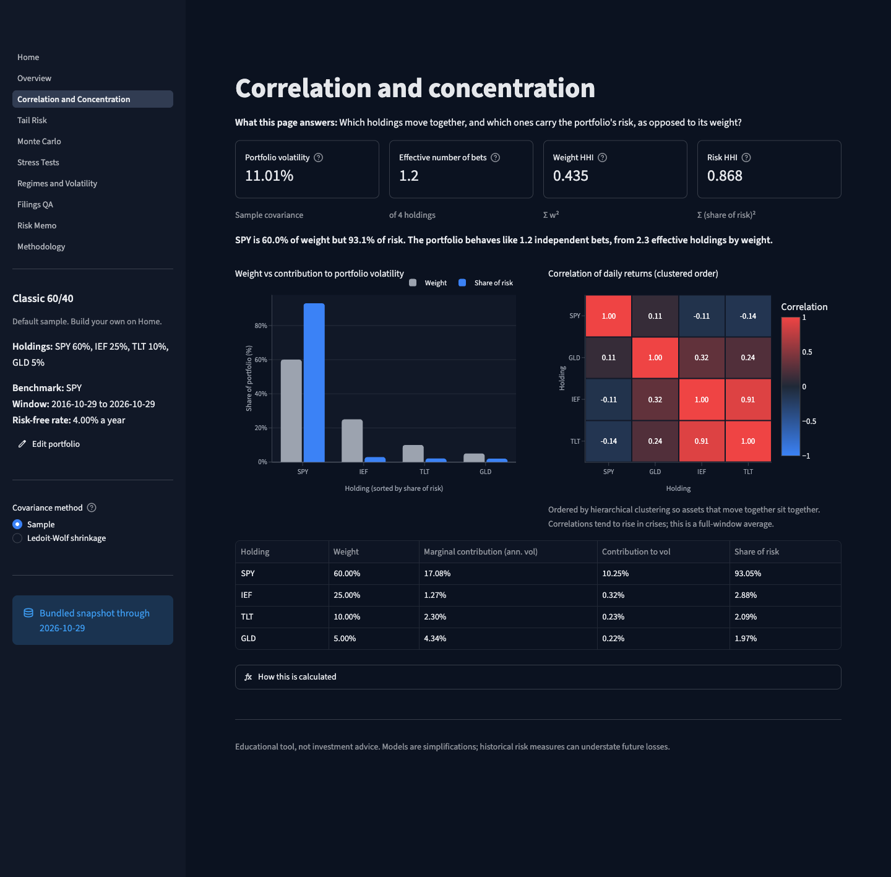
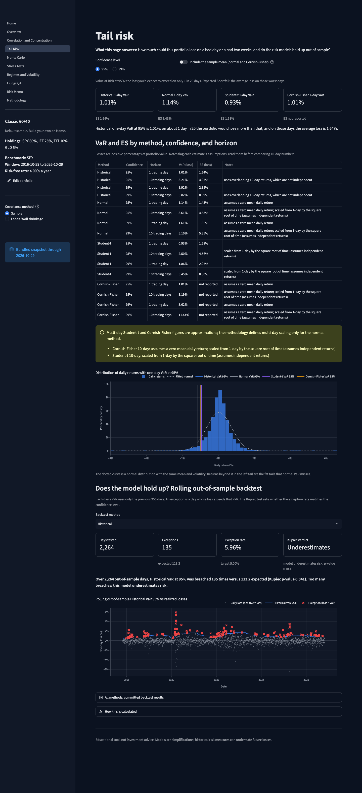
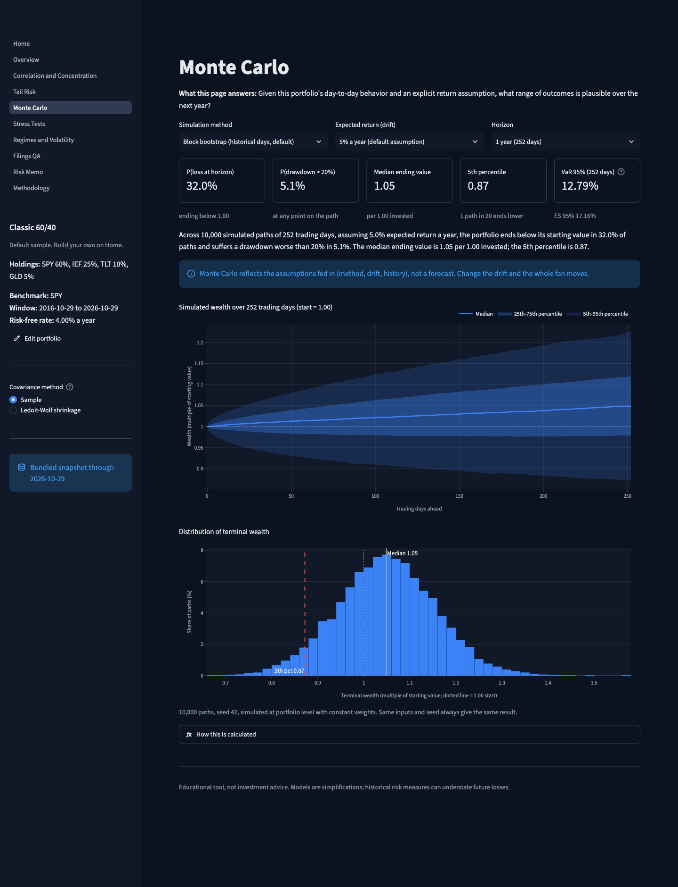
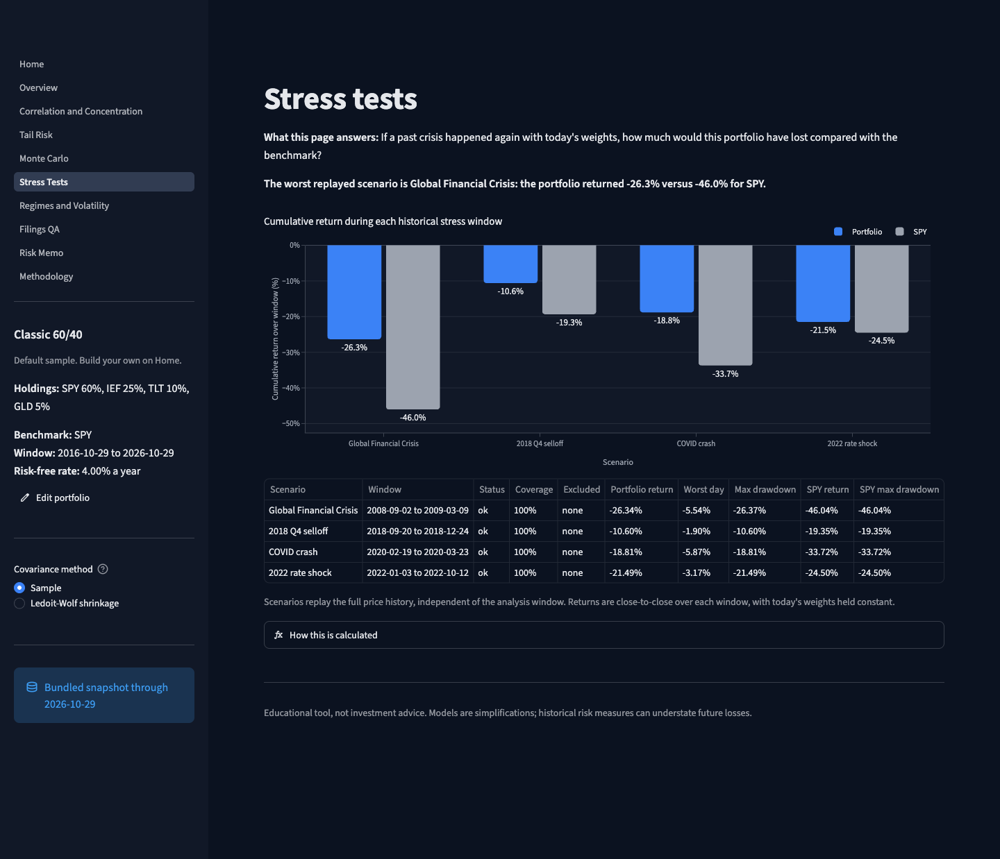
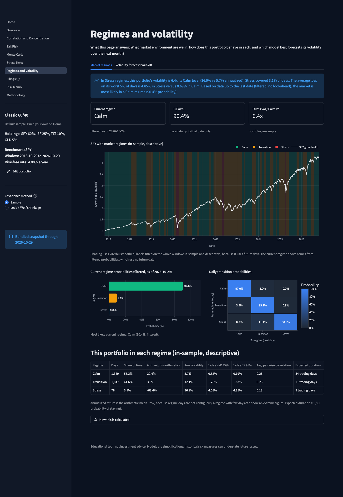
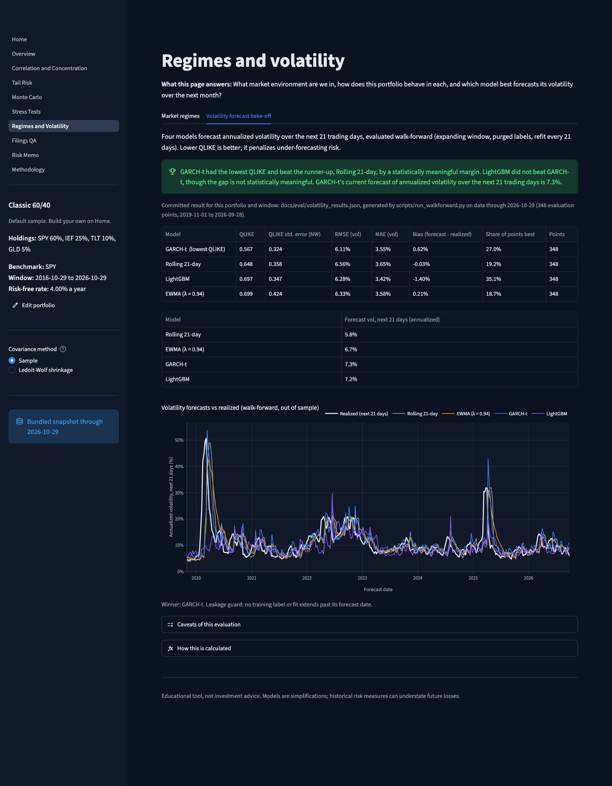
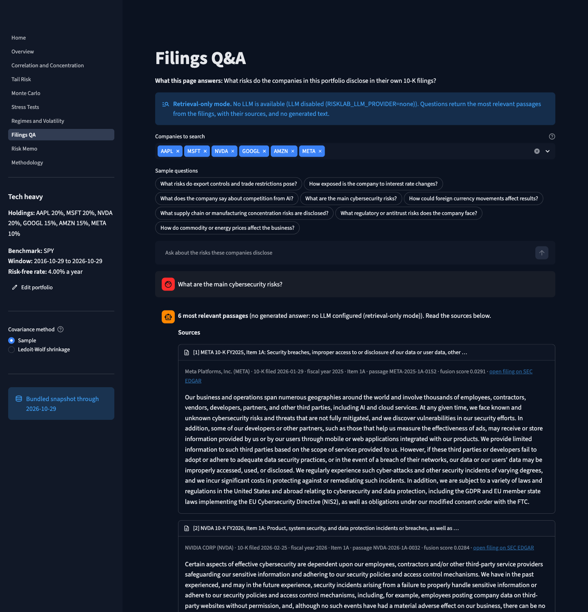
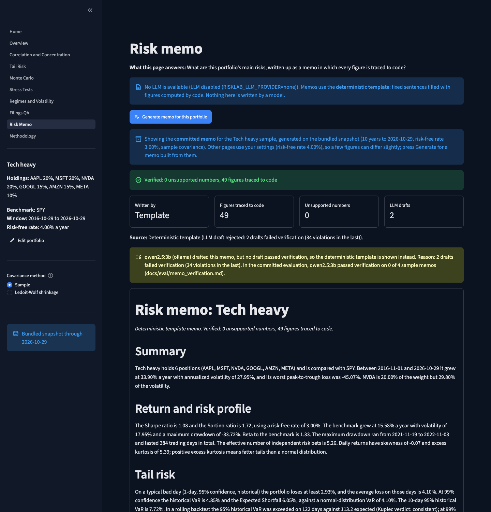
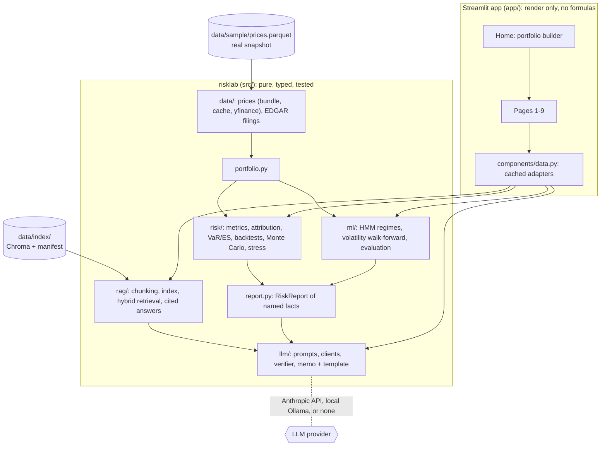

# Portfolio Risk Lab

**How can this portfolio fail?** A Streamlit app that stress-tests a stock and ETF portfolio with classical risk analytics, machine learning that is measured against simple baselines, and LLM features that are not allowed to type a single number.

[](https://github.com/danielloewinger3-alt/portfolio-risk-lab/actions/workflows/ci.yml)
&nbsp;**Live demo:** _LIVE URL PLACEHOLDER: add the Streamlit Community Cloud link after deploying (see [`docs/PROGRESS.md`](docs/PROGRESS.md#morning-handoff-finalized-at-m9))_



## Why this is different

- **Honest evaluation.** Every model faces a baseline in a walk-forward test, and the app reports what lost: GARCH-t beat the gradient-boosted model, and normal VaR failed its 99% backtests.
- **The LLM never types a number.** Memos are drafted with placeholders such as `[[fact:var_95_hist]]`; code substitutes each figure and a verifier rejects any other digit. When the model fails, a deterministic template takes over.
- **No lookahead.** Every forecasting function has a future-perturbation test: replace everything after day *t* with noise and the forecast at *t* must not change. Walk-forward labels are purged.
- **Tested maths.** Known-answer anchors, independent reference implementations and property-based tests (ES ≥ VaR, risk contributions sum to volatility), with coverage gates in CI.
- **Runs anywhere.** A bundled real price snapshot and a prebuilt SEC filings index mean the app starts with no network, no API key and no secrets.

## Feature tour

| | |
|---|---|
| **Overview**: CAGR, volatility, Sharpe, Sortino, max drawdown, beta; cumulative return vs benchmark, underwater chart, rolling volatility, monthly heatmap | **Correlation and concentration**: clustered correlation heatmap, Euler risk contributions vs weights, effective number of bets |
|  |  |
| **Tail risk**: VaR and Expected Shortfall (historical, normal, Student-t, Cornish-Fisher) at 95/99% and 1/10 days; rolling out-of-sample backtest with the Kupiec test in plain language | **Monte Carlo**: stationary block bootstrap, Student-t or normal; fan chart, terminal distribution, P(loss) and P(drawdown > 20%) |
|  |  |
| **Stress tests**: GFC, 2018 Q4, COVID crash, 2022 rate shock on today's weights, with coverage rules for late-listing holdings | **Regimes and volatility**: 3-state HMM with filtered (not smoothed) current-regime probabilities; walk-forward bake-off of rolling, EWMA, GARCH-t and LightGBM forecasts |
|  |  |
| **Filings Q&A**: hybrid retrieval (dense + BM25, reciprocal rank fusion) over the holdings' latest 10-K risk factors; cited answers, or the source passages in retrieval-only mode | **Risk memo**: verified memo with a "figures traced to code" badge and Markdown download |
|  |  |

The **Methodology and validation** page renders every formula, assumption and limitation, plus [`docs/VALIDATION.md`](docs/VALIDATION.md).

## Architecture



The memo pipeline: `build_report()` turns every analysis into named facts → the model drafts JSON with placeholders and citations → `verify_memo()` rejects stray digits, unknown placeholders and unknown citations → one retry with the violations listed → otherwise the deterministic template → code substitutes the figures.

## Results

All numbers below are quoted from [`docs/VALIDATION.md`](docs/VALIDATION.md), which `make validate` generates from scripts run on the bundled real snapshot (10 years of daily data to 2026-10-29, four sample portfolios).

- **VaR backtests** (4 portfolios × 2 confidence levels, Kupiec test at 5%): **Cornish-Fisher passed the most runs, 7 of 8**. Historical passed 5 of 8. **Normal passed all 4 at 95% but 0 of 4 at 99%**: it understates the far tail. Student-t, fitted on rolling 250-day windows, passed 1 of 8.
- **Volatility forecasting** (purged walk-forward, QLIKE): **GARCH-t had the lowest QLIKE on 4 of 4 portfolios; LightGBM beat GARCH-t on 0 of 4.** The winner's lead over the runner-up was statistically meaningful (Newey-West) on 1 of 4, so the honest summary is "GARCH-t is at least as good, and the ML model did not earn its complexity here".
- **Regimes** (3-state HMM on SPY): annualized volatility Calm 8.2%, Transition 19.1%, Stress 60.1%; portfolio volatility in Stress regimes is 4.5x to 6.4x its Calm level. In-sample labels were identical on 100.0% of days across 5 alternative seeds.
- **Filings retrieval** (on a **synthetic** gold set of 26 questions written by the build agent, so a sanity check rather than a benchmark): hit@6 with one company's filings was 100.0% hybrid vs 96.2% dense; with a five-company filter, dense scored 96.2% vs 92.3% hybrid. **Dense retrieval alone was competitive with hybrid.** Citation validity: 936 of 936.
- **LLM memos**: the local `qwen2.5:3b` model **failed verification on 4 of 4 sample memos, even after a retry**. The verifier caught 64 violations in first drafts (mostly numbers typed from the facts list), so **every committed memo is the deterministic template**, with 0 unsupported numbers. The UI says which source produced each memo.
- **Filings Q&A** with the same model: of 9 questions, 6 verified on the first pass and 3 after a retry; 13 claims kept and 1 dropped by the verifier; citation validity 100.0%.
- **Tests**: 496 passed, 0 failed (live-network tests deselected); coverage 97.6% overall, and every docs/07 gate met (`risk/` 99.7%, `ml/` 98.8%, `llm/verify.py` 100.0%, `rag/chunking.py` 96.4%).

## Methodology highlights and limitations

- Simple daily returns, a daily-rebalanced portfolio, and VaR/ES reported as positive loss fractions. Formulas are in [`docs/04-methodology.md`](docs/04-methodology.md) and on the Methodology page.
- VaR says nothing about losses beyond the threshold, and 99% backtests over about 2,264 days have little power. Multi-day Student-t and Cornish-Fisher VaR use √h scaling, which the app flags.
- The regime model is fitted in-sample; regime labels on the chart are descriptive. Only the filtered current-regime probability is forward-safe.
- Each result comes from one 10-year window that includes COVID and the 2022 rate shock. Other periods can rank models differently.
- The retrieval gold set is synthetic, and MD&A could not be extracted for 3 filers (see [`docs/BLOCKERS.md`](docs/BLOCKERS.md)).
- A 3B local model cannot write a verified memo here. LLM-written memos need a larger model (for example `qwen2.5:7b`) or an Anthropic API key.
- Prices are a static snapshot. Live mode fetches from Yahoo Finance and falls back to the bundle.

## Run locally

Requires Python 3.12 and [uv](https://docs.astral.sh/uv/).

```bash
git clone https://github.com/danielloewinger3-alt/portfolio-risk-lab.git
cd portfolio-risk-lab
make setup          # uv sync (on macOS also links LightGBM to scikit-learn's libomp)
make app            # streamlit run app/Home.py -> http://localhost:8501
```

Or with plain pip: `python3.12 -m venv .venv && .venv/bin/pip install -r requirements.txt && .venv/bin/streamlit run app/Home.py`. On macOS, LightGBM needs an OpenMP runtime: `brew install libomp`, or run `scripts/dev/macos_lightgbm_libomp.sh` once to link it to the copy scikit-learn ships. Without it the app still runs, but the volatility bake-off reports that LightGBM could not load.

No keys are needed. Optional LLM features:

```bash
cp .env.example .env
# Anthropic: set ANTHROPIC_API_KEY=...  (RISKLAB_LLM_PROVIDER=auto picks it up)
# Local Ollama: install from https://ollama.com, then
ollama pull qwen2.5:3b        # or qwen2.5:7b (about 4.7 GB), set RISKLAB_OLLAMA_MODEL to match
# RISKLAB_LLM_PROVIDER=ollama
```

Other commands: `make check` (ruff, mypy, pytest with coverage gates), `make validate` (rerun evaluations and rebuild `docs/VALIDATION.md`), `make data` (refresh the price snapshot), `make index` (rebuild the filings index; set `SEC_USER_AGENT`), `make export-reqs`.

## Tests and CI

GitHub Actions runs `ruff check`, `ruff format --check`, `mypy src`, and `pytest -m "not network"` with coverage gates from [`docs/07`](docs/07-testing-and-validation.md): at least 85% for `risk/`, `ml/`, `llm/verify.py` and `rag/chunking.py`, and 75% overall. The suite includes the no-lookahead tests, the LLM safety tests (with a scripted fake LLM), and Streamlit `AppTest` smoke tests for every page and sample portfolio. No test touches the network.

## Project docs

Specs and logs live in [`docs/`](docs/): decisions, product spec, architecture, methodology, ML and RAG/LLM specs, testing, UI, task breakdown, deployment, data spec, plus the build logs [`PROGRESS.md`](docs/PROGRESS.md), [`DEVIATIONS.md`](docs/DEVIATIONS.md) and [`BLOCKERS.md`](docs/BLOCKERS.md). [`AGENTS.md`](AGENTS.md) holds the rules the build agents followed.

## Data notice and disclaimer

Prices are from Yahoo Finance via `yfinance`, bundled only so the demo runs offline. Filings are from SEC EDGAR. See [`DATA_NOTICE.md`](DATA_NOTICE.md).

**Educational tool, not investment advice.** Models are simplifications; historical risk measures can understate future losses.

License: [MIT](LICENSE).
